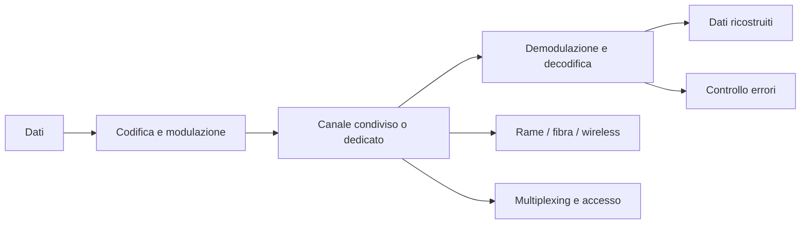

# Schema finale da ricordare

## Concetti chiave

> **1.** Un segnale analogico varia in modo continuo; un segnale digitale rappresenta l'informazione con simboli finiti.

> **2.** La modulazione digitale associa i simboli a variazioni della portante; il ricevitore demodula il segnale.

> **3.** ASK, FSK, PSK e QAM si distinguono per la caratteristica della portante che viene modificata.

> **4.** TDM, FDM e WDM permettono di condividere il canale nel tempo, in frequenza o per lunghezza d'onda.

> **5.** Codifica in linea, sincronizzazione e controllo degli errori contribuiscono a trasferire correttamente i dati.

> **6.** Rame, fibra e collegamenti wireless hanno caratteristiche e ambiti d'uso differenti.

> **7.** Il throughput utile non coincide necessariamente con la capacità nominale del collegamento.

> **8.** La commutazione di circuito riserva risorse; quella di pacchetto condivide i collegamenti tra più flussi.

---

## Collegamenti con i capitoli successivi

Questi concetti introducono lo studio delle reti: protocolli, indirizzamento, dispositivi di interconnessione e architetture che consentono ai sistemi di comunicare.
